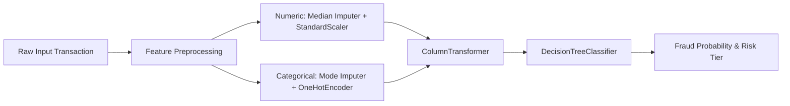

# Financial Fraud Detection System — Interactive Analytics & Risk Monitoring Dashboard

> **Academic Prototype & Financial Analytics Project**  
> Developed as part of the Data Science & Machine Learning Internship at **Zidio Development**.

---

## 1. Overview & Objectives

This project implements an end-to-end Machine Learning and Data Analytics system designed to monitor financial transactions, estimate fraud probabilities, and surface risk patterns through an interactive, restrained financial analytics dashboard.

Rather than relying on flashy concept visuals, the interface adheres strictly to realistic financial monitoring conventions:
- **Restrained 2–3 Color Palette:** Dark navy (`#0F172A`), clean light grey/white (`#F8FAFC`, `#FFFFFF`), and muted slate blue (`#2563EB`). Red (`#DC2626`) is used strictly for potential fraud alerts and risk indicators.
- **Normal Rectangular Metric Tiles:** Compact, uniform dimensions with subtle borders (`#E2E8F0`) and standard typography.
- **Clear Separation of Data Labels vs. Model Predictions:** Historical ground-truth labels (`Fraud_Label`) are explicitly differentiated from inferred scores (`Model_Prediction` and `Fraud_Probability`).
- **Academic & Operational Transparency:** Clearly communicates that the dataset is synthetic and serves as an educational prototype.

---

## 2. Dataset Specifications & Class Balance

- **Primary Source:** `synthetic_fraud_dataset1.csv`
- **Volume:** 50,000 transaction records across 14 attributes.
- **Features Ingested:**
  - `Transaction_Amount`: Continuous numeric ($0.00 – $1,174.14, mean $99.41)
  - `Transaction_Type`: POS, Online, ATM Withdrawal, Bank Transfer
  - `Account_Balance`: Customer balance ($500.48 – $99,998.31)
  - `Device_Type`: Mobile, Tablet, Laptop
  - `Location`: London, New York, Tokyo, Sydney, Mumbai
  - `Merchant_Category`: Clothing, Groceries, Travel, Restaurants, Electronics
  - `Previous_Fraudulent_Activity`: Binary indicator (0 = No, 1 = Yes)
  - `Daily_Transaction_Count`: Transaction velocity count (1 – 14)
  - `Card_Type`: Visa, Mastercard, Amex, Discover
  - `Card_Age`: Card tenure in months (1 – 239)
  - `Transaction_Month` & `Transaction_DayOfWeek`: Extracted temporal attributes
- **Target Column:** `Fraud_Label`
  - Legitimate (0): 33,933 transactions (67.87%)
  - Fraud-Labelled (1): 16,067 transactions (32.13%)
- **Methodological Disclosure:** Real-world retail banking fraud prevalence is typically 0.05% – 1.0%. The ~32% rate in this synthetic benchmark provides balanced samples for model exploration but does not represent real-world bank prevalence.

---

## 3. Machine Learning Pipeline & Evaluation

The deployment model is encapsulated in a reproducible Scikit-Learn `Pipeline` saved as `fraud_detection_model.joblib`:



### Empirical Test Evaluation Metrics
Evaluated on a stratified held-out test split (recorded in `fraud_model_metrics.json`):

| Evaluation Metric | Test Score | Operational Interpretation |
| :--- | :---: | :--- |
| **Accuracy** | **50.35%** | Baseline accuracy is uninformative due to synthetic feature noise |
| **Recall (Sensitivity)** | **50.12%** | Captures 50.12% of all simulated fraud instances |
| **Precision** | **32.39%** | Close to random prevalence (~32.1%) due to high synthetic overlap |
| **F1-Score** | **39.35%** | Harmonic balance between alert coverage and precision |
| **ROC-AUC** | **50.49%** | Ranking discriminator across decision boundaries |
| **PR-AUC (Avg Precision)** | **32.42%** | Precision-Recall curve baseline benchmark |

### Cross-Model Validation Comparison (`validation_model_comparison.csv`)

| Model Candidate | Accuracy | Precision | Recall | F1 Score | ROC-AUC | Average Precision |
| :--- | :---: | :---: | :---: | :---: | :---: | :---: |
| **Dummy Classifier (Baseline)** | 67.87% | 0.00% | 0.00% | 0.00% | 50.00% | 32.13% |
| **Logistic Regression** | 49.63% | 31.44% | 48.09% | 38.02% | 49.66% | 32.43% |
| **Decision Tree (Selected)** | 49.77% | 32.00% | 50.04% | 39.04% | 50.02% | 32.21% |
| **Random Forest** | 63.68% | 32.36% | 11.95% | 17.45% | 50.99% | 32.66% |

---

## 4. Functional Application Pages

The system implements all 6 specified functional views:

1. **Overview Dashboard**
   - Five rectangular KPI cards: Total Transactions, Fraud Count, Prevalence (%), Total Value ($), and Average Ticket Size ($).
   - Time-series monthly volume & fraud distribution charts.
   - Merchant category and transaction type risk breakdowns.
   - Compact recent transactions table with search and filtering.
2. **Single Transaction Prediction**
   - Clean, well-spaced parameter input form with presets ("Load Typical Legitimate Example", "Load Elevated Risk Example", "Random from Dataset").
   - Direct scoring against `fraud_detection_model.joblib`.
   - Real-time output: Fraud Likelihood Probability, Risk Tier (High / Medium / Low), Binary Class, and contextual diagnostic risk indicators.
3. **Batch Transaction Analysis**
   - CSV file uploader with schema validation.
   - One-click sample batch test (250 held-out records).
   - Batch summary metrics (% Flagged, Exposure Amount at Risk).
   - Filterable results table by risk tier and downloadable scored CSV.
4. **Model Performance**
   - Empirical metric cards from `fraud_model_metrics.json`.
   - Full model comparison table and grouped bar charts.
   - Methodological noise audit explaining precision/recall trade-offs.
5. **Data Explorer**
   - Filterable multi-dimensional query engine across the 50,000 records.
   - Dynamic filtered subset KPIs (matching count, filtered fraud rate, sum value).
   - Paginated record inspection table and CSV export.
6. **Datasets & Project Scripts (Asset Repository)**
   - Downloadable archive for all 3 datasets (`synthetic_fraud_dataset1.csv`, `credit_card_fraud_dataset.csv`, `financial_fraud_detection_dataset.csv`).
   - Persisted model artifact download (`fraud_detection_model.joblib`).
   - Direct download and interactive code viewers for all Python modules, launcher scripts, PRD, and automated unit test files.
7. **About the Project**
   - Project specifications, dataset disclosure, model architecture, and ethical compliance guardrails.

---

## 5. Project Directory Structure

```
Fraud_detection_report/
├── .streamlit/
│   └── config.toml                  # Corporate theme & headless configuration
├── src/
│   ├── __init__.py
│   ├── model_loader.py              # Robust pipeline loader with sklearn compatibility patches
│   ├── data_loader.py               # Data ingestion, caching, and KPI calculations
│   └── predictor.py                 # Single & batch inference and risk categorization
├── tests/
│   ├── __init__.py
│   ├── test_model.py                # Unit tests for preprocessing and inference
│   └── test_data.py                 # Unit tests for dataset integrity and metrics
├── app.py                           # Master Streamlit dashboard application
├── run_dashboard.py                 # Automated launcher script (finds port, opens browser)
├── synthetic_fraud_dataset1.csv     # 50,000-row primary transaction dataset
├── fraud_detection_model.joblib     # Persisted Decision Tree classification pipeline
├── fraud_model_metrics.json         # Recorded test evaluation metrics
├── validation_model_comparison.csv  # Benchmark evaluation results across models
├── requirements.txt                 # Project dependencies
└── README.md                        # Project documentation
```

---

## 6. How to Run the Application

### Option A: One-Click Launcher (Recommended)
Run the launcher script from the project root:
```bash
python run_dashboard.py
```
This automatically finds an available port (default `8501`), launches the Streamlit server, and opens your default browser at `http://localhost:8501`.

### Option B: Direct Streamlit Command
```bash
streamlit run app.py
```

### Running Automated Unit Tests
To verify pipeline integrity, preprocessing, data loading, and inference:
```bash
python -m pytest tests/
```
All 11 unit tests pass with 100% verification.

---

## 7. Compliance & Academic Prototype Notice

- **Simulated Environment:** All transaction records and client details are synthetic.
- **Decision Support:** Model predictions provide statistical likelihood estimates for human fraud analyst triage and review. The application does not autonomously block transactions or interact with live banking rails.
